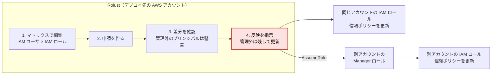
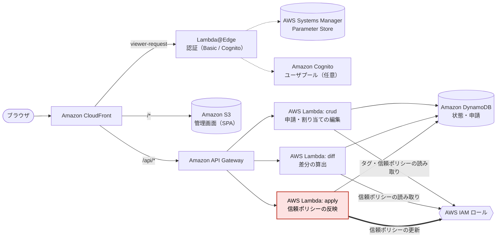

# Rolust

[English](README.md) | **日本語**

Rolust は、AWS IAM ロールの**信頼ポリシー**を、申請と差分の確認を経て更新する管理ツールです。自分の AWS アカウントにデプロイして使います。

- **信頼ポリシー**（`AssumeRolePolicyDocument`）は、その IAM ロールを誰（どの IAM ユーザやサービス）が引き受けられるかを決める JSON です。
- Rolust は、信頼ポリシーのうち、Rolust が管理しているプリンシパルだけを足し引きします。サービスプリンシパル・他アカウントの root・フェデレーテッド ID など、管理していないものは**削除せず、そのまま残します**。

> **開発状況**: poc（proof of concept）です。実運用の前に、[制約と既知の帰結](docs/guide/README.md#制約と既知の帰結)（日本語）を必ず読んでください。
>
> ライセンスは [Apache License 2.0](LICENSE) です。

## できること

IAM ユーザと IAM ロールの割り当てを表（マトリクス）で編集し、差分を確認してから、信頼ポリシーに反映します。

- **マトリクスで編集:** IAM ユーザ × IAM ロールの表にチェックを入れて、割り当てを決めます。この時点では AWS に何も書き込みません。
- **申請と差分の確認:** 追加・削除されるプリンシパルを反映の前に確認します。Rolust の管理外のプリンシパルには警告が出ます。
- **管理外は残して反映:** 反映を指示するまで、信頼ポリシーは変わりません。反映の成否はロールごとに表示され、失敗した申請は再反映できます。
- **別アカウントのロール:** 別の AWS アカウントのロールも、同じ画面で扱えます。相手側には、同梱の CloudFormation テンプレートでロールを 2 つ作ります。
- **乖離の確認と修復:** Rolust の外から信頼ポリシーが変えられていないかを確認し、どちらを正とするかを選んで直せます。
- **アクセス制限:** Basic 認証または Amazon Cognito、IP アドレスの制限（任意）に対応します。
- **表示言語:** 画面は日本語と英語で表示できます。

## 構成

管理画面は、Amazon CloudFront から配信する SPA（React と AWS Cloudscape）です。API は Amazon API Gateway と AWS Lambda、データは Amazon DynamoDB に置きます。AWS の資源は Terraform で一式を作ります。

Lambda を 3 系統に分けているのは、権限を分けるためです。信頼ポリシーを書き換える権限（`iam:UpdateAssumeRolePolicy`）は、特権昇格の経路になりうるので、`apply` だけに持たせています。マトリクスの編集を担う `crud` は、IAM への書き込み権限を持ちません。

## 試す

導入（setup）・認証（access-control）・クロスアカウント（cross-account）の手順書は**英語版もあります**。ほかの手順書は日本語のみです。ここでは流れだけを示します。詳しくは [docs/guide/setup.md](docs/guide/setup.md) を読んでください（英語版は [docs/guide/en/setup.md](docs/guide/en/setup.md)）。

必要なもの:

- AWS アカウント 1 つ（デプロイ先）。IAM ロールとポリシーを作れる認証情報
- Terraform 1.10 以上
- bash と jq（Windows では Git Bash）
- Terraform の state を置く S3 バケット（無ければ、同梱の `infra/bootstrap/` が作ります）

流れ（Release の tarball から入れる経路です。`npm` もリポジトリの取得も要りません）:

1. [Releases](https://github.com/kazuki-kudo/rolust/releases) から、`rolust-vX.Y.Z.tar.gz` と `SHA256SUMS` を取得し、チェックサムを確かめて展開します。「Source code」の zip や tar.gz は使わないでください（ビルド前のソースです）。
2. Terraform の state の置き場所（`infra/backend.hcl`）と、変数（`infra/terraform.tfvars`）を用意します。認証方式（`auth_mode`）は、apply の前のここで決めます。
3. `terraform init -backend-config=backend.hcl` → `terraform plan` → `plan-guard.sh`（plan の差分から権限の拡大を検査する付属のスクリプト）→ `terraform apply` の順に実行します。
4. 認証の資格情報を設定します（既定の Basic 認証では、SSM に投入します）。
5. `terraform -chdir=infra output -raw console_url` で表示された URL を開きます。

## 手順書

利用者向けの手順書は [docs/guide/](docs/guide/README.md) にあります。`setup.md`・`access-control.md`・`cross-account.md` は英語版もあります（表にリンクがあります）。ほかは日本語のみです。

| 文書 | 内容 |
|---|---|
| [overview.md](docs/guide/overview.md) | できること・できないこと、構成、表示言語 |
| [setup.md](docs/guide/setup.md)（[English](docs/guide/en/setup.md)） | 前提と、入手から動作確認までの手順 |
| [access-control.md](docs/guide/access-control.md)（[English](docs/guide/en/access-control.md)） | 認証方式（Basic / Cognito）、管理者の権限、IP アドレス制限 |
| [cross-account.md](docs/guide/cross-account.md)（[English](docs/guide/en/cross-account.md)） | 別アカウントのロールを管理するための準備 |
| [managed-roles.md](docs/guide/managed-roles.md) | 管理対象のロール（タグ、登録、乖離を直す操作、削除） |
| [users.md](docs/guide/users.md) | ユーザプールの制約と、登録できるアカウントの許可リスト |
| [operations.md](docs/guide/operations.md) | 新しい版への更新、SPA の反映、アンインストール |
| [limitations.md](docs/guide/limitations.md) | Terraform の state の機微情報、そのほかの制約 |

## 開発に加わる

開発に加わる人は、リポジトリの `CONTRIBUTING.md` と `docs/development.md` を読んでください（Release の tarball には入っていません）。

## 脆弱性の報告

脆弱性は、公開の Issue ではなく GitHub の private vulnerability reporting で報告してください。手順と対象の範囲は [SECURITY.md](SECURITY.md) にあります。

## ライセンス

[Apache License 2.0](LICENSE)。
