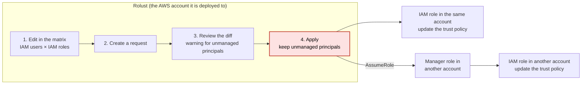
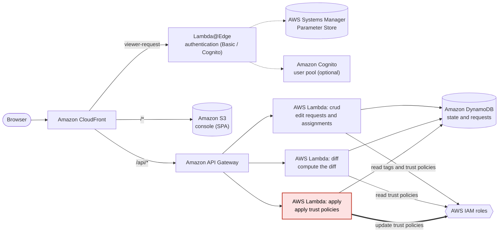

# Rolust

**English** | [日本語](README.ja.md)

Rolust is a management tool that updates the **trust policies** of AWS IAM roles, through requests and a reviewed diff. You deploy it into your own AWS account.

- A **trust policy** (`AssumeRolePolicyDocument`) is the JSON that decides who (which IAM users or services) can assume an IAM role.
- Rolust adds and removes only the principals in a trust policy that Rolust manages. It **keeps the others as they are and never removes them**, such as service principals, the root of another account, and federated identities.

> **Status**: proof of concept (poc). Before using it in production, read [Constraints and known consequences](docs/guide/README.md#制約と既知の帰結) (in Japanese).
>
> Rolust is licensed under the [Apache License 2.0](LICENSE).

## What it does

You edit the assignment of IAM users to IAM roles in a matrix, review the diff, and then apply it to the trust policies.

- **Edit in a matrix:** Check cells in a table of IAM users × IAM roles to decide the assignments. Nothing is written to AWS at this point.
- **Requests and diff review:** Before anything is applied, you review the principals that will be added or removed. Principals that Rolust does not manage are flagged with a warning.
- **Apply, keeping unmanaged principals:** Trust policies do not change until you tell Rolust to apply. The result is shown per role, and a failed request can be applied again.
- **Roles in other accounts:** Roles in other AWS accounts are handled in the same screen. On the other side, you create two roles with the bundled CloudFormation template.
- **Drift detection and repair:** Rolust checks whether a trust policy was changed outside Rolust, and you can fix the difference by choosing which side is correct.
- **Access control:** Basic authentication or Amazon Cognito, and an optional IP address restriction.
- **Display language:** The screen is available in Japanese and English.

## Architecture

The console is a SPA (React and AWS Cloudscape) served from Amazon CloudFront. The API runs on Amazon API Gateway and AWS Lambda, and the data is stored in Amazon DynamoDB. Terraform creates all of the AWS resources.

The Lambda functions are split into three so that their permissions can be separated. The permission to rewrite trust policies (`iam:UpdateAssumeRolePolicy`) can be a path to privilege escalation, so only `apply` has it. `crud`, which handles editing the matrix, has no write permission to IAM.

## Try it

The setup, authentication, and cross-account guides are available **in English**; the other guides are in Japanese only. This section shows only the flow. For the details, read [docs/guide/en/setup.md](docs/guide/en/setup.md) (the Japanese original is [docs/guide/setup.md](docs/guide/setup.md)).

You need:

- One AWS account to deploy to, and credentials that can create IAM roles and policies
- Terraform 1.10 or later
- bash and jq (Git Bash on Windows)
- An S3 bucket for the Terraform state (if you have none, the bundled `infra/bootstrap/` creates one)

The flow (installing from the Release tarball; you need neither `npm` nor a clone of the repository):

1. Download `rolust-vX.Y.Z.tar.gz` and `SHA256SUMS` from [Releases](https://github.com/kazuki-kudo/rolust/releases), verify the checksum, and extract the tarball. Do not use the "Source code" zip or tar.gz; it is the source before the build.
2. Prepare the place for the Terraform state (`infra/backend.hcl`) and the variables (`infra/terraform.tfvars`). Choose the authentication mode (`auth_mode`) here, before the apply.
3. Run `terraform init -backend-config=backend.hcl`, `terraform plan`, `plan-guard.sh` (a bundled script that checks the plan for changes that widen permissions), and `terraform apply`, in this order.
4. Set the authentication credentials (with the default Basic authentication, you put them in SSM).
5. Open the URL printed by `terraform -chdir=infra output -raw console_url`.

## Guides

The user guides are in [docs/guide/](docs/guide/README.md). `setup.md`, `access-control.md`, and `cross-account.md` also have English versions (linked in the table); the others are in Japanese only.

| Document | Contents |
|---|---|
| [overview.md](docs/guide/overview.md) | What Rolust can and cannot do, architecture, display language |
| [setup.md](docs/guide/setup.md) ([English](docs/guide/en/setup.md)) | Prerequisites, and the steps from getting Rolust to checking that it works |
| [access-control.md](docs/guide/access-control.md) ([English](docs/guide/en/access-control.md)) | Authentication (Basic / Cognito), administrator permissions, IP address restriction |
| [cross-account.md](docs/guide/cross-account.md) ([English](docs/guide/en/cross-account.md)) | Preparing to manage roles in another account |
| [managed-roles.md](docs/guide/managed-roles.md) | Managed roles (tags, registration, fixing drift, removal) |
| [users.md](docs/guide/users.md) | Limits of the user pool, and the allow list of accounts that can be registered |
| [operations.md](docs/guide/operations.md) | Updating to a new version, deploying the SPA, uninstalling |
| [limitations.md](docs/guide/limitations.md) | Sensitive data in the Terraform state, and other constraints |

## Contributing

If you want to contribute, read `CONTRIBUTING.md` and `docs/development.md` in the repository (they are not included in the Release tarball).

## Reporting a vulnerability

Report vulnerabilities through GitHub's private vulnerability reporting, not in a public issue. The procedure and what is in scope are in [SECURITY.md](SECURITY.md).

## License

[Apache License 2.0](LICENSE).
